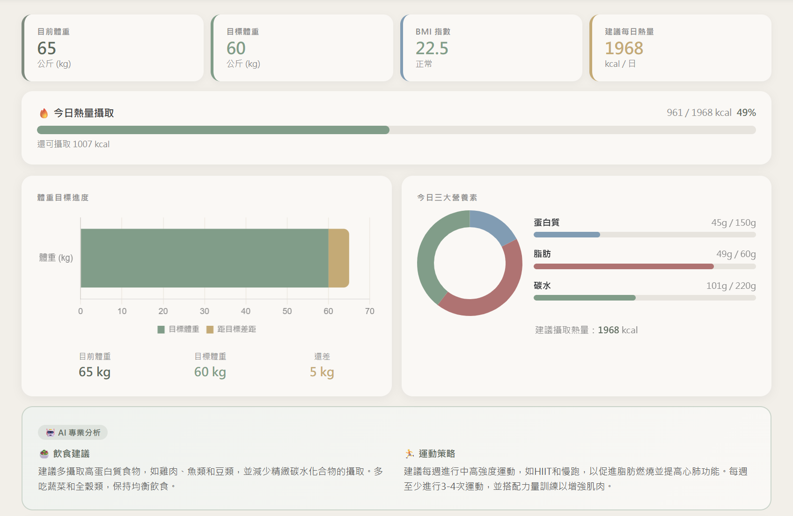
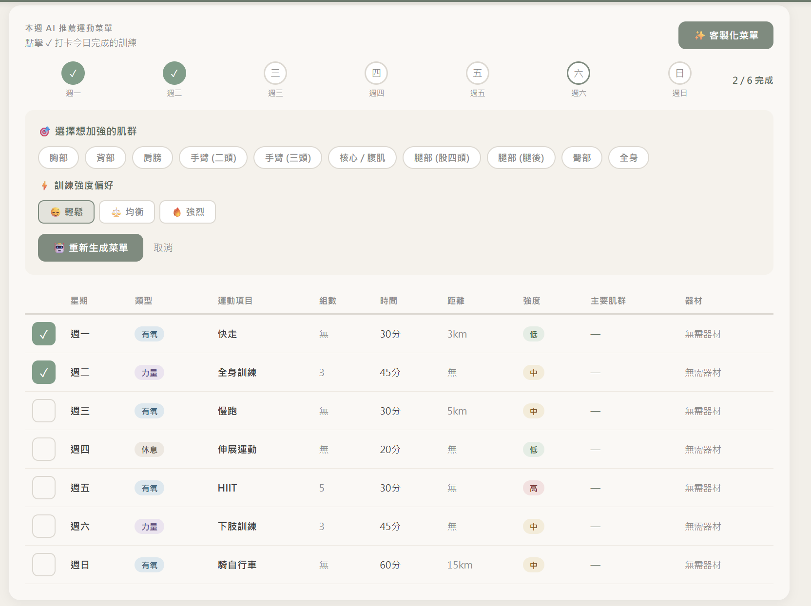
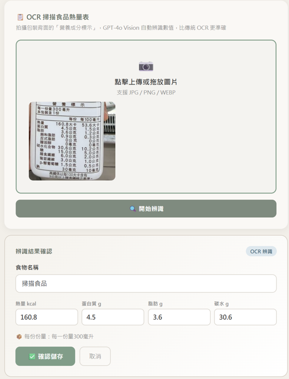
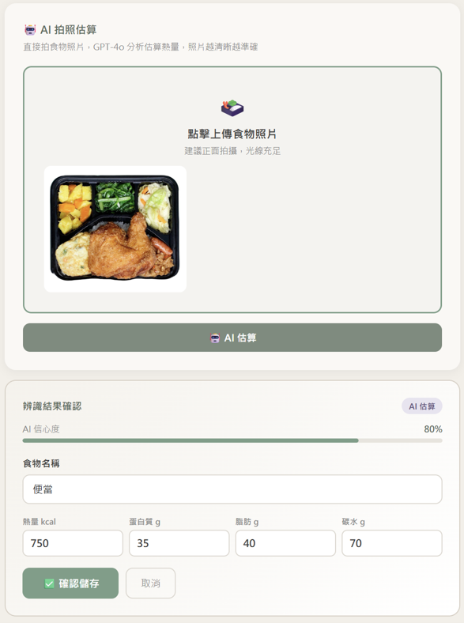
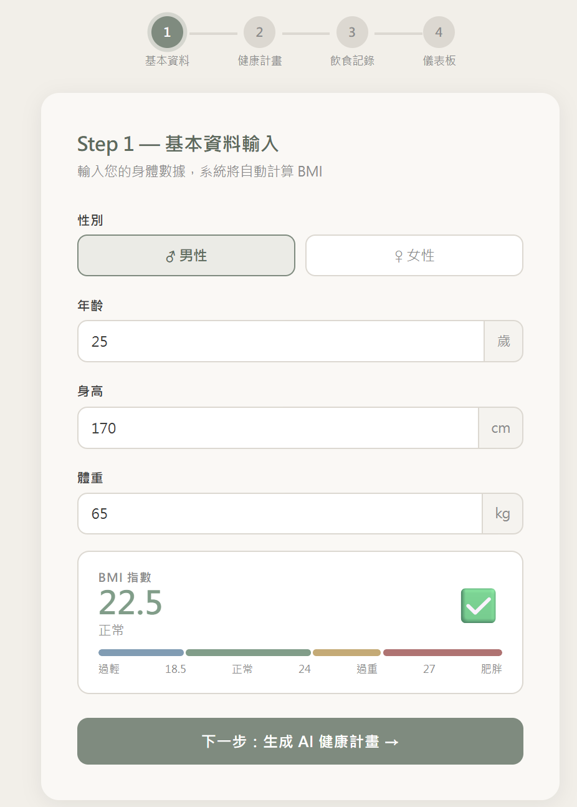
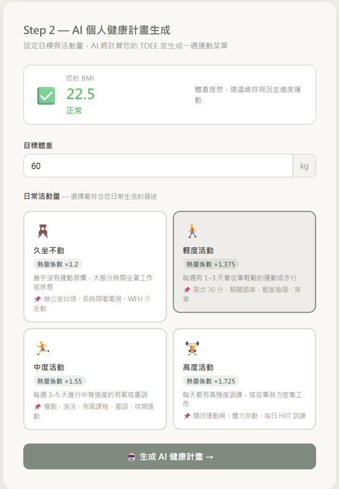

# AI 智能健康管理系統

> 輸入身高體重，由 GPT 生成個人化飲食與一週運動計畫；拍下營養標示或餐點照片，AI 自動辨識熱量並記錄到儀表板。



## 功能

| 步驟 | 功能 | 做法 |
|------|------|------|
| Step 1 基本資料 | 輸入性別、年齡、身高、體重，即時計算 BMI 與分級 | Flask Session + 前端即時計算 |
| Step 2 健康計畫 | 依目標體重與活動量計算 TDEE，生成每日熱量、三大營養素建議與一週運動菜單 | Mifflin-St Jeor 公式 + GPT-4o-mini（JSON 輸出） |
| Step 3 飲食記錄 | 三種記錄方式：拍營養標示、拍餐點照片、手動輸入；儲存前可確認與修正數值 | GPT-4o Vision |
| Dashboard | 今日熱量進度、營養素圓餅圖、體重目標、運動菜單打卡、依肌群偏好重新生成菜單 | Chart.js |

**AI 一週運動菜單：可打卡，並依肌群與強度偏好重新生成**



**影像辨識：營養標示（左）與餐點照片（右）**

<p>
  
  
</p>

**基本資料與健康計畫設定**

<p>
  
  
</p>

## 設計重點

- **AI 失敗時仍可使用**：沒有 API key 或呼叫失敗時，系統以公式計算營養素並套用預設運動菜單，流程不會中斷。
- **結構化輸出**：所有 LLM 呼叫都使用 `response_format={"type": "json_object"}`，並在 prompt 中指定欄位格式，讓回傳結果可以直接寫入資料庫與前端圖表。
- **人工確認**：影像辨識結果不直接儲存，先顯示在確認區讓使用者修正，信心度低時提示使用者檢查。
- **公式與 AI 分工**：BMI、BMR（Mifflin-St Jeor）、TDEE 由程式計算，確保數字可驗證；LLM 只負責需要判斷與文字生成的部分（飲食建議、運動菜單、影像辨識）。

## 技術

- **後端**：Python、Flask、SQLite
- **AI**：OpenAI GPT-4o（影像辨識）、GPT-4o-mini（健康計畫生成）
- **前端**：Bootstrap 5、Chart.js

## 本機執行

```bash
git clone https://github.com/<你的帳號>/ai-health-management.git
cd ai-health-management

python -m venv venv
# Windows: venv\Scripts\activate
# macOS / Linux: source venv/bin/activate

pip install -r requirements.txt
```

將 `.env.example` 複製為 `.env`，填入 OpenAI API key：

```env
OPENAI_API_KEY=your_openai_api_key_here
SECRET_KEY=any_random_string
```

```bash
python app.py
```

開啟 http://localhost:5000。資料庫 `health.db` 會在第一次啟動時自動建立。

## 專案結構

```
├── app.py              # Flask 路由、BMI/TDEE 計算、OpenAI 呼叫、SQLite 存取
├── templates/          # step1 ~ step3、dashboard 頁面
├── static/css/         # 樣式
├── docs/screenshots/   # README 截圖
└── requirements.txt
```

## 限制與未來改進

- 目前以 Flask Session 識別使用者，沒有登入機制，適合單人示範。
- 餐點照片的熱量是 AI 估算值，份量判斷誤差較大。
- 可加入每日紀錄的歷史趨勢圖，以及以實際體重變化回饋調整計畫。
